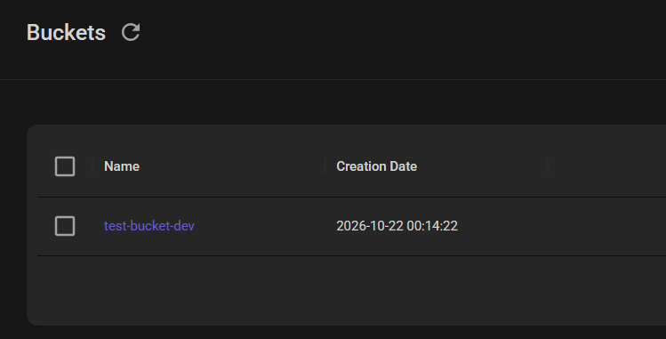

# Bucket S3 local con Terraform

Proyecto de práctica que utiliza Terraform y el proveedor de AWS para crear un bucket S3 en [LocalStack](https://www.localstack.cloud/), sin conectarse a una cuenta real de AWS.

Use LocalStack para poder crear servicios de aws sin tener que crear una cuenta.

Decidí probar con crear un bucket en el servicio S3.

## Estructura del proyecto

```text
.
├── main.tf            # Recurso del bucket S3
├── outputs.tf         # Nombre del bucket creado
├── provider.tf        # Versiones y configuración de AWS/LocalStack
├── variables.tf       # Declaración de variables
└── terraform.tfvars   # Valores utilizados localmente
```

## s3 creado en localStack
